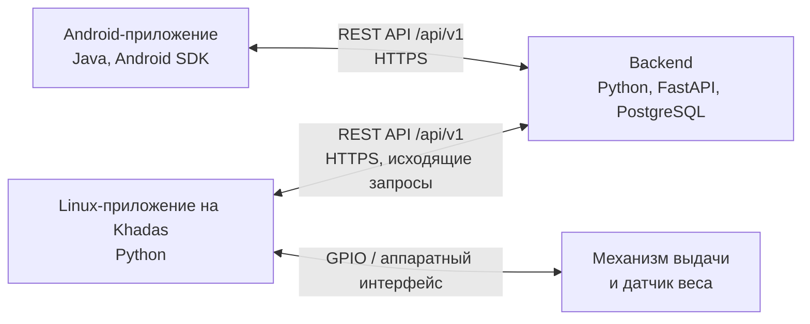
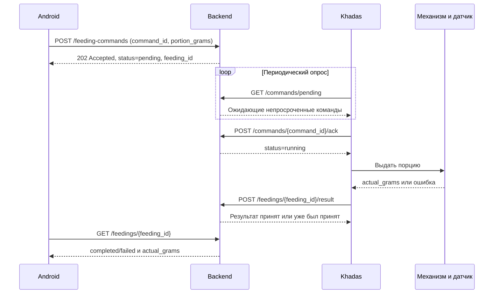
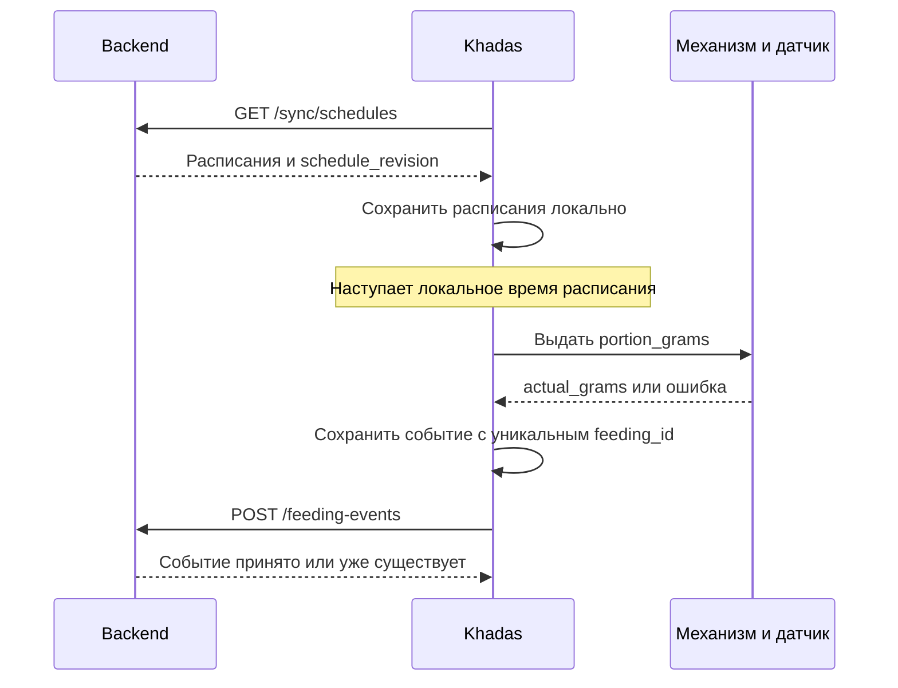

# Архитектура Smart Cat Feeder

## Назначение системы

Smart Cat Feeder — автоматизированная система кормления домашних животных с мобильным управлением и контролем фактически выданной массы корма. Система поддерживает кормление по расписанию, ручную выдачу порции, измерение результата датчиком веса, историю операций, отображение состояния и уведомления о завершении кормления и ошибках.

## Компоненты

Android взаимодействует только с backend. Прямое соединение Android с Khadas не входит в основную архитектуру. Khadas инициирует исходящие REST-запросы к backend, поэтому backend не требуется устанавливать входящее соединение с устройством через интернет.

### Backend

- предоставляет Android и Khadas контракт REST API из [api.md](api.md);
- хранит устройства, расписания, ручные команды и историю кормлений в PostgreSQL;
- авторизует клиентов и разграничивает доступ к устройствам;
- принимает телеметрию, результаты и ошибки Khadas;
- ставит удалённые команды в очередь и отдаёт их при опросе устройством;
- не запускает повторно кормления, которые Khadas выполняет локально по расписанию;
- формирует данные для состояния, истории и уведомлений Android.

### Linux-приложение на Khadas

- хранит локальную копию актуальных расписаний и выполняет их независимо от сети;
- периодически получает конфигурацию и ожидающие ручные команды с backend;
- обеспечивает идемпотентное выполнение каждой ручной команды по `command_id`;
- управляет механизмом выдачи через GPIO и получает измерения датчика веса;
- сохраняет локально неотправленные события и результаты до подтверждённой синхронизации;
- сообщает backend состояние, начало выполнения команды, итоговый статус и `actual_grams`.

Модель Khadas, механизм выдачи, модель датчика веса, электрическая схема, конкретные GPIO-линии и совместимость библиотек требуют уточнения командой. До выбора оборудования эти параметры не фиксируются.

### Android-приложение

- создаёт, изменяет и удаляет расписания через backend;
- отправляет уникальные ручные команды;
- показывает состояние кормушки, историю и состояние отдельного кормления;
- отображает уведомления о завершении кормления и ошибках на основании данных backend;
- не считает принятие ручной команды подтверждением выдачи корма.

## Зоны ответственности

Backend является источником истины для централизованных данных и версии расписаний. Khadas является источником истины для факта физического выполнения и измеренной массы. Android является пользовательским клиентом и не управляет оборудованием напрямую.

Граница ответственности по времени выполнения расписания проходит на Khadas: backend распространяет расписание, а устройство определяет наступление запуска по `time_local`, `days_of_week` и `timezone`. Backend не создаёт удалённую команду для такого запуска.

## Ручное кормление

Backend сохраняет команду со сроком `expires_at`. Повторный запрос Android с тем же `command_id` возвращает прежнюю команду и не создаёт новую. Khadas перед началом проверяет срок действия и журнал уже обработанных `command_id`. Истёкшая команда получает `expired` и не выполняется. `202 Accepted` означает только постановку команды в очередь.

## Автоматическое кормление

Для каждого автономного запуска Khadas заранее создаёт и устойчиво сохраняет уникальный `feeding_id`. Повторная отправка события с тем же `feeding_id` идемпотентна. Backend не инициирует это кормление и не дублирует его командой.

## Синхронизация расписаний

Каждое изменение набора расписаний увеличивает серверный `schedule_revision`. Khadas периодически запрашивает актуальный набор и после успешной проверки атомарно заменяет локальную копию. В ответ передаются все расписания устройства, включая неактивные, чтобы удаление или деактивация не потерялись. Удалённое расписание представляется полем `deleted_at` до тех пор, пока политика очистки не позволит убрать его из синхронизации.

Расписание задаётся локальным временем `time_local`, днями `days_of_week` и IANA-идентификатором `timezone`. События и служебные временные метки передаются в UTC в ISO 8601. Поведение при переводе часов и смене часового пояса должно быть проверено отдельно.

## Работа без связи

- Khadas продолжает выполнять последнюю успешно сохранённую версию активных расписаний.
- Новые ручные команды недоступны до восстановления связи и не считаются выполненными.
- Телеметрия, ошибки и результаты кормлений сохраняются в локальной устойчивой очереди.
- Android видит последнее известное backend состояние; устаревание определяется по `last_seen_at`.
- PostgreSQL на Khadas не требуется; формат локального хранилища выбирает Linux-команда при сохранении гарантий устойчивости и уникальности.

## Ошибки

Ошибки механизма, датчика, валидации команды и выполнения фиксируются с `error_code`, безопасным описанием `error_message`, временем и связанными идентификаторами. При ошибке кормление завершается статусом `failed`; частично измеренная масса при наличии передаётся в `actual_grams`. Сетевой сбой сам по себе не превращает физически выполненное кормление в `failed`: результат остаётся в локальной очереди до синхронизации.

Справочник `error_code` должен быть согласован до реализации. Минимально контракт допускает `MOTOR_ERROR`, `WEIGHT_SENSOR_ERROR`, `DEVICE_BUSY`, `INVALID_PORTION` и `INTERNAL_ERROR`; его расширение не должно менять формат ответа.

## Восстановление соединения

После появления сети Khadas выполняет операции в следующем порядке:

1. Отправляет текущее состояние и обновляет `last_seen_at`.
2. Получает актуальную версию расписаний, проверяет и атомарно сохраняет её.
3. Отправляет накопленные события в порядке возникновения. Повторы безопасны благодаря уникальному `feeding_id`.
4. Получает ожидающие ручные команды.
5. Отбрасывает просроченные команды и подтверждает только допустимые к выполнению.
6. Возобновляет обычный периодический обмен.

Точные интервалы опроса, срок действия ручной команды, пороги отклонения массы, политика повторов и критерий состояния `offline` требуют подтверждения командой.
